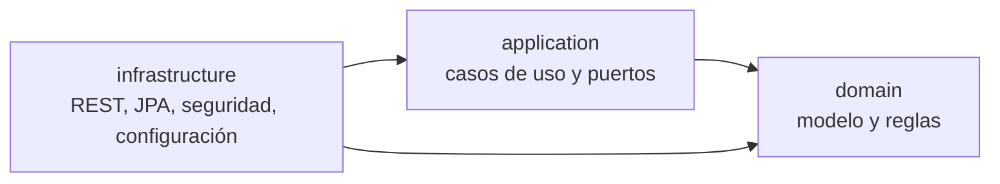

# SOLGASES APP — Backend del MVP 1

API REST para gestionar el catálogo, el inventario, los usuarios, los roles y los permisos de **SOLGASES**, empresa de seguridad industrial de Sogamoso, Boyacá (Colombia). SOLGASES comercializa elementos de protección personal y gases industriales, recarga extintores y repara equipos de soldadura.

Es el proyecto final de un curso de desarrollo de software asistido por IA. Las reglas técnicas y de trabajo con IA están escritas en [`docs/lineamientos.md`](docs/lineamientos.md) y [`CLAUDE.md`](CLAUDE.md).

## Qué incluye el MVP 1

El MVP 1 es **solo backend** ([`docs/mvp1.md`](docs/mvp1.md)):

- **Catálogo:** categorías, unidades de medida y productos.
- **Inventario:** existencias por producto y movimientos de entrada, salida y ajuste.
- **Usuarios y accesos:** usuarios internos, roles, permisos y credenciales locales.
- **Seguridad:** login con JWT y autorización por matriz de permisos, consultada en cada petición.
- **Contrato y pruebas de API:** OpenAPI/Swagger y colección Postman.

Frontend, catálogo público, chatbot y WhatsApp corresponden a MVP posteriores ([`docs/roadmap_mvps_solgases.md`](docs/roadmap_mvps_solgases.md)).

## Stack

| Área | Tecnología |
|---|---|
| Lenguaje y framework | Java 21, Spring Boot 3.5.16, Spring Security |
| Persistencia | Spring Data JPA, MySQL 8.4 (Docker local; DataSource JNDI en WebLogic) |
| Seguridad | JWT HS256 de 15 minutos, contraseñas con Argon2id |
| Pruebas y calidad | JUnit 5, Mockito, ArchUnit, JaCoCo, SonarQube |
| Entrega | Maven multimódulo, WAR, Jenkins, Oracle WebLogic 15.1.1 en una VM Red Hat 9.8 |

## Arquitectura

Clean Architecture en tres módulos Maven. Las dependencias apuntan hacia el dominio, y las pruebas ArchUnit fallan el build si alguna capa rompe esa regla.

| Módulo | Responsabilidad |
|---|---|
| `domain` | Modelo y reglas de negocio, sin Spring ni JPA |
| `application` | Casos de uso, puertos y DTO |
| `infrastructure` | API REST, persistencia, seguridad y configuración |

Más detalle en [`docs/architecture.md`](docs/architecture.md), [`docs/data-model.md`](docs/data-model.md) y los [ADR](docs/adr).

## Entrega continua

El [`Jenkinsfile`](Jenkinsfile) ejecuta estas etapas: checkout → compilación → pruebas (incluye ArchUnit) → WAR y cobertura JaCoCo → análisis SonarQube → Quality Gate → despliegue en WebLogic por SSH y WLST.

- **Último resultado confirmado por el equipo:** el build **#12** terminó en verde, con todas las etapas y el despliegue incluidos, y **Quality Gate Passed**.
- **Métricas de Sonar:** son **solo de New Code**. Están en [`docs/DevOps.md`](docs/DevOps.md#sonarqube) con su alcance exacto.
- **Política del Quality Gate:** es no bloqueante por decisión documentada en [ADR-0004](docs/adr/0004-jenkins-sonarqube-weblogic.md).

## Cómo empezar

1. **Lee el contexto:** este README y luego [`docs/architecture.md`](docs/architecture.md).
2. **Compila y prueba:** con Java 21 y Maven, ejecuta `mvn -B clean verify`. Genera el WAR y los reportes JaCoCo.
3. **Levanta el entorno de laboratorio:** sigue [`docs/inicio_rápido.md`](docs/inicio_rápido.md) (VM, MySQL, SonarQube, Jenkins y WebLogic). La configuración de las herramientas está en [`docs/DevOps.md`](docs/DevOps.md).
4. **Prueba la API:** usa Swagger UI en `/infrastructure/swagger-ui/index.html` dentro de WebLogic, la especificación [`docs/openapi.json`](docs/openapi.json) o la [colección Postman](docs/postman/solgases.postman_collection.json) con su [entorno](docs/postman/solgases.postman_environment.json).

Los secretos (credenciales de base de datos, `JWT_SECRET` y tokens) no están en el repositorio. Para el perfil local, copia [`.env.example`](.env.example) a `.env`, que Git ignora, y completa tus propios valores.

## Documentación

| Para… | Documento |
|---|---|
| Ver el índice completo de `docs/` | [`docs/README.txt`](docs/README.txt) |
| Entender requisitos y alcance | [`docs/analisis_requerimientos_solgases.md`](docs/analisis_requerimientos_solgases.md), [`docs/mvp1.md`](docs/mvp1.md) |
| Conocer la solución | [`docs/architecture.md`](docs/architecture.md), [`docs/data-model.md`](docs/data-model.md), [`docs/adr`](docs/adr) |
| Ejecutar y desplegar | [`docs/inicio_rápido.md`](docs/inicio_rápido.md), [`docs/DevOps.md`](docs/DevOps.md) |
| Ver la presentación | [`docs/presentacion_solgases_mvp1.pptx`](docs/presentacion_solgases_mvp1.pptx) |

## Estado y temas abiertos

Esto es un entorno de laboratorio, no una instalación de producción. Los temas pendientes están documentados:

- **Argon2id frente a BCrypt:** la guía de evaluación menciona BCrypt y está pendiente de confirmar con el instructor ([ADR-0003](docs/adr/0003-jwt-argon2id.md)).
- **Java 21 frente a Java 25:** la guía menciona Java 25 ([ADR-0005](docs/adr/0005-java-21-en-webLogic.md)).
- **Vulnerabilidades en dependencias de Spring:** OWASP Dependency-Check sigue en `BUILD FAILURE` por CVE de Spring sin corrección compatible, y la decisión sigue pendiente ([`docs/mvp1.md`](docs/mvp1.md), Incremento 8).
- **Checkpoint 8 incompleto:** faltan la imagen Docker, el registro de artefactos, los smoke tests automatizados y el rollback.
