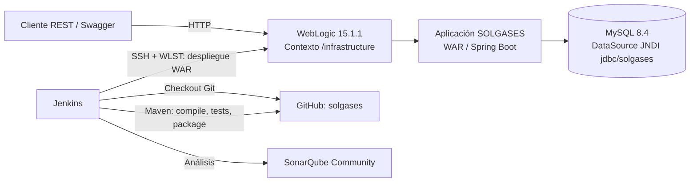
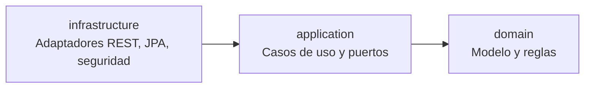
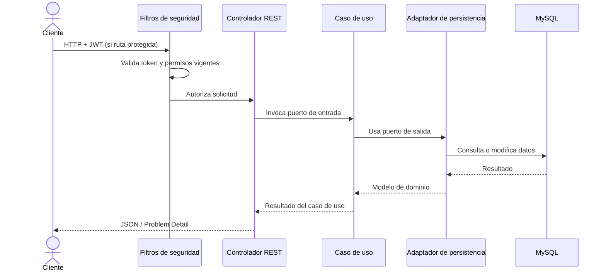

# Arquitectura de SOLGASES

> Estado: documentación inicial basada en el repositorio y la configuración observada el 21 de octubre de 2026. La guía de reglas del proyecto es [`lineamientos.md`](lineamientos.md).

## 1. Propósito y alcance

Este documento resume la arquitectura implementada de SOLGASES, sus módulos, límites de responsabilidad, seguridad, integración de datos y entrega continua. Describe el estado actual; las propuestas aún no aprobadas se identifican como tales.

## 2. Contexto

SOLGASES es una API backend para administrar catálogo, inventario y usuarios, roles y permisos. Los consumidores se conectan por HTTP/JSON. La aplicación persiste en MySQL y se empaqueta como WAR para WebLogic 15.1.1. Jenkins compila, prueba, analiza con SonarQube y despliega en la máquina virtual Red Hat.

## 3. Estructura y dependencias

El proyecto Maven aplica Clean Architecture en tres módulos:

| Módulo | Responsabilidad | Dependencias principales |
|---|---|---|
| `domain` | Modelo y reglas de negocio independientes de frameworks | JUnit y AssertJ únicamente para pruebas |
| `application` | Casos de uso, puertos de entrada/salida, DTO y coordinación transaccional | `domain`, Spring Tx |
| `infrastructure` | API REST, persistencia JPA, seguridad, configuración y adaptadores | `application`, Spring Boot, MySQL y WebLogic |

La regla de dependencias apunta hacia el dominio: el dominio no conoce infraestructura ni Spring. La infraestructura implementa los puertos definidos por la aplicación. Además de la estructura modular de Maven, la regla se verifica con pruebas ArchUnit (`infrastructure/src/test/java/com/solgases/infrastructure/architecture/CleanArchitectureTest.java`) que se ejecutan en `mvn test`: `domain` solo depende de sí mismo y de paquetes `java.*` (no de otros paquetes del JDK como `javax.*`, `jdk.*` o `sun.*`), `application` no depende de `infrastructure`, y las dependencias permitidas son `infrastructure → application → domain` e `infrastructure → domain`. El uso de `spring-tx` (`@Transactional`) en `application` es una excepción documentada y no se restringe (ver ADR-0006).

## 4. Flujo de una solicitud

Las rutas públicas de autenticación no requieren JWT. Las rutas protegidas validan autorización por matriz de permisos; las verificaciones de permisos se realizan en cada solicitud. Los errores REST se representan con `ProblemDetail` (RFC 9457).

## 5. Seguridad

| Aspecto | Estado actual |
|---|---|
| Autenticación | Token JWT emitido por `POST /api/auth/token` |
| Firma | HS256; clave externa mediante `JWT_SECRET`, Base64 y mínimo 256 bits |
| Duración | 15 minutos; sin refresh token |
| Contraseñas | Argon2id con parámetros configurados en `application.yml` |
| Autorización | Matriz de permisos consultada en cada petición; rechazo cerrado |
| Sesiones | API sin estado (stateless) |
| CORS | Deshabilitado mientras no se definan orígenes de cliente |
| CSRF | Deshabilitado; ver evidencia para el hotspot de SonarQube más abajo |
| WebLogic | Perfil `dev`, JNDI `jdbc/solgases`; secretos fuera del WAR |

**Evidencia para revisar el hotspot `java:S4502` (CSRF deshabilitado en `SecurityConfiguration`).** CSRF explota credenciales que el navegador adjunta de forma automática (cookies de sesión, autenticación HTTP Basic o formulario). En esta API:

- `sessionCreationPolicy(SessionCreationPolicy.STATELESS)`: Spring Security no crea ni usa `HttpSession` para autenticar.
- `httpBasic`, `formLogin`, `logout` y `requestCache` están deshabilitados; no hay autenticación por cookie ni recordatorio de sesión.
- El único mecanismo de autenticación es el resource server JWT (`oauth2ResourceServer().jwt()`) con el `BearerTokenResolver` por defecto, que solo lee la cabecera `Authorization: Bearer` (no admite token en parámetros de URL ni en cuerpos de formulario); no hay un resolver personalizado.
- `POST /api/auth/token` devuelve el token en el cuerpo JSON (`AccessTokenResponse`, `tokenType` `Bearer`) y no emite `Set-Cookie`; el cliente debe adjuntarlo de forma explícita.
- CORS no se considera una protección contra CSRF. La justificación se basa en que la API no usa credenciales que el navegador adjunte automáticamente; el cliente envía el JWT explícitamente en la cabecera Authorization: Bearer.
- `SecurityIntegrationTest` usa la cabecera `Authorization: Bearer` y verifica `WWW-Authenticate: Bearer` en 401.

Esa justificación es válida mientras el token no se transporte en cookies ni se introduzcan sesiones o autenticación Basic/formulario; cualquiera de esos cambios obliga a reactivar CSRF. La revisión y el cambio de estado del hotspot se hacen en la interfaz de SonarQube.

La matriz de evaluación menciona BCrypt. La implementación y las decisiones del MVP describen Argon2id. Se debe confirmar con el docente si la rúbrica exige BCrypt antes de cambiar el diseño.

## 6. Perfiles, base de datos y despliegue

| Entorno | Configuración de datos |
|---|---|
| Local | URL JDBC parametrizada por `DB_HOST`, `DB_PORT`, `DB_NAME`; valores locales definidos en `.env` |
| WebLogic en VM | DataSource `SolgasesDS`, JNDI `jdbc/solgases`; usuario y contraseña se configuran en el servidor |

El Compose del proyecto expone MySQL en el anfitrión por el puerto `3307`; desde la VM se usa la dirección de gateway del anfitrión y ese puerto. No usar el contenedor `student-mysql`, que pertenece a otro proyecto.

La aplicación se publica en WebLogic bajo `/infrastructure`. La documentación operativa y los comandos de arranque están en [`inicio_rápido.md`](inicio_rápido.md); el detalle de Jenkins y la configuración de herramientas está en [`DevOps.md`](DevOps.md).

## 7. Pipeline de CI/CD

Jenkins toma el `Jenkinsfile` desde `develop` y ejecuta estas etapas:

1. Checkout de Git.
2. Compilación Maven.
3. Pruebas unitarias y empaquetado/cobertura.
4. Análisis SonarQube.
5. Espera del Quality Gate; si falla, marca el build `UNSTABLE` y permite continuar (comportamiento deliberado actual).
6. Transferencia segura del WAR y script WLST a Red Hat mediante SSH/SCP y redeploy en WebLogic.
7. Registro de resultados de pruebas y archivado de artefactos.

La etapa de despliegue solo puede considerarse exitosa si WLST concluye el redeploy sin error. Verificar la aplicación en `/infrastructure/swagger-ui/index.html` y `/infrastructure/v3/api-docs`.

## 8. Pruebas y observabilidad

El pipeline registra resultados JUnit y archiva artefactos. Las pruebas de integración de seguridad cubren respuestas no autorizadas y tokens inválidos/expirados. Se han reportado coberturas locales altas en `domain` y `application`; reproducir las cifras con el reporte del build antes de presentarlas como métrica vigente.

## 9. Decisiones pendientes de validar

| Tema | Situación | Acción recomendada |
|---|---|---|
| Java 21 frente a Java 25 | POM, lineamientos y despliegue WebLogic usan Java 21; una meta de la rúbrica menciona Java 25 | Confirmar cuál versión exige la evaluación; no migrar sin validar WebLogic |
| Argon2id frente a BCrypt | Código y MVP adoptan Argon2id; rúbrica menciona BCrypt | Acordar con docente si la rúbrica es normativa o solo indicativa |
| Quality Gate | Actualmente no bloquea el despliegue; la última medición observada dio ERROR | Mantener el comportamiento acordado; documentar el riesgo y decidir una política de bloqueo cuando el equipo lo determine |

## 10. Fuentes internas

- `docs/lineamientos.md`
- `docs/mvp1.md`
- `pom.xml` y POM de cada módulo
- `infrastructure/src/main/resources/application.yml`
- `Jenkinsfile`
- `docker-compose.yml` y `docker-compose.sonar.yml`
- `deployment/weblogic_deploy.py`
