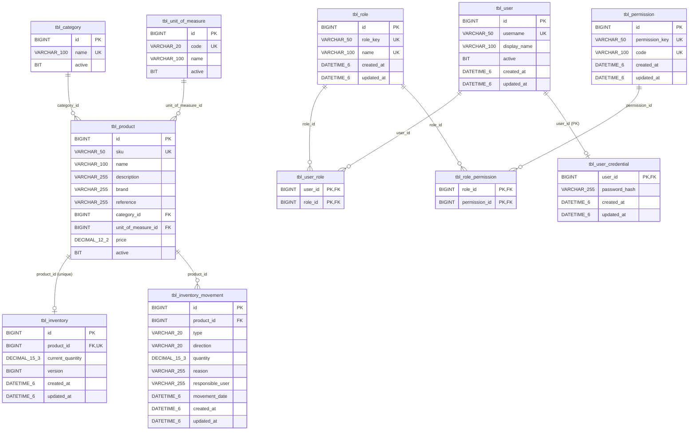

# Modelo de datos de SOLGASES

> Estado: documentación del código vigente en la rama `feature/MVP1_CI_CD`, revisada el 2026-10-24. Describe la implementación existente; no propone cambios. El contrato HTTP está en [`openapi.json`](openapi.json) y la arquitectura general en [`architecture.md`](architecture.md).

## 1. Propósito y alcance

El modelo persiste la información del MVP 1 de SOLGASES:

- **Catálogo:** categorías, unidades de medida y productos.
- **Inventario:** existencia actual por producto e historial de movimientos (entradas, salidas y ajustes).
- **Usuarios y accesos:** usuarios internos, roles, permisos y la credencial local de cada usuario.

Fuentes usadas:

| Fuente | Ubicación |
|---|---|
| Entidades JPA | `infrastructure/src/main/java/com/solgases/infrastructure/persistence/entity/` |
| Repositorios Spring Data | `infrastructure/src/main/java/com/solgases/infrastructure/persistence/repository/` |
| Adaptadores y mapeadores de persistencia | `infrastructure/src/main/java/com/solgases/infrastructure/persistence/` |
| Modelo de dominio | `domain/src/main/java/com/solgases/domain/model/` |
| DTO HTTP | `infrastructure/src/main/java/com/solgases/infrastructure/api/dto/` |
| Configuración JPA por perfil | `infrastructure/src/main/resources/application*.yml` |

**No hay migraciones de base de datos.** El repositorio no incluye Flyway, Liquibase ni scripts `schema.sql`. El esquema lo genera Hibernate a partir de las entidades:

| Perfil | `spring.jpa.hibernate.ddl-auto` | Efecto |
|---|---|---|
| `local`, `dev` | `update` | Hibernate crea tablas y columnas que falten; no elimina ni modifica columnas existentes |
| `qa`, `prd` | `validate` | Hibernate solo comprueba que el esquema coincida con las entidades |

Los tipos SQL de este documento salen del DDL que generó Hibernate 6.6.53 con el dialecto MySQL (8.4) para las nueve entidades. Se generó sin conexión a ninguna base de datos (ver §8.1). El esquema real de una base existente puede diferir si se creó con una versión anterior de las entidades, porque `update` no altera columnas existentes.

## 2. Visión general

Hay nueve entidades JPA y once tablas físicas: nueve de entidad más dos tablas de unión `@ManyToMany`.

| Área | Entidad JPA | Tabla | Modelo de dominio |
|---|---|---|---|
| Catálogo | `CategoryJpaEntity` | `tbl_category` | `Category` |
| Catálogo | `UnitOfMeasureJpaEntity` | `tbl_unit_of_measure` | `UnitOfMeasure` |
| Catálogo | `ProductJpaEntity` | `tbl_product` | `Product` |
| Inventario | `InventoryJpaEntity` | `tbl_inventory` | `Inventory` |
| Inventario | `InventoryMovementJpaEntity` | `tbl_inventory_movement` | `InventoryMovement` |
| Accesos | `PermissionJpaEntity` | `tbl_permission` | `Permission` |
| Accesos | `RoleJpaEntity` | `tbl_role` | `Role` |
| Accesos | `UserJpaEntity` | `tbl_user` | `User` |
| Accesos | `UserCredentialJpaEntity` | `tbl_user_credential` | — (solo `StoredCredential` en `application`) |
| Accesos | (unión de `RoleJpaEntity.permissions`) | `tbl_role_permission` | — |
| Accesos | (unión de `UserJpaEntity.roles`) | `tbl_user_role` | — |

Enumeraciones de dominio persistidas como texto (`@Enumerated(EnumType.STRING)`):

| Enumeración | Valores | Columna |
|---|---|---|
| `MovementType` | `ENTRY`, `EXIT`, `ADJUSTMENT` | `tbl_inventory_movement.type` |
| `MovementDirection` | `INCREASE`, `DECREASE` | `tbl_inventory_movement.direction` |

## 3. Catálogo de entidades

Convenciones comunes:

- Todas las claves primarias son `BIGINT AUTO_INCREMENT` (`GenerationType.IDENTITY`), excepto la de `tbl_user_credential`, que comparte la clave del usuario (`@MapsId`).
- Los `boolean` se mapean a `BIT NOT NULL`; los `Instant` a `DATETIME(6)`.
- Ninguna columna tiene `DEFAULT` en la base de datos. Los valores iniciales los asigna el código Java: en constructores y en callbacks `@PrePersist`/`@PreUpdate`.
- Las entidades no usan anotaciones de Bean Validation; las validaciones de entrada están en los DTO HTTP (§5).

### 3.1 `CategoryJpaEntity` → `tbl_category`

Agrupa productos.

| Atributo Java | Columna | Tipo Java | Tipo SQL | Restricciones |
|---|---|---|---|---|
| `id` | `id` | `Long` | `BIGINT AUTO_INCREMENT` | PK |
| `name` | `name` | `String` | `VARCHAR(100)` | `NOT NULL`, único (`uk_category_name`) |
| `active` | `active` | `boolean` | `BIT` | `NOT NULL`; `true` al crear |

No tiene columnas de auditoría.

### 3.2 `UnitOfMeasureJpaEntity` → `tbl_unit_of_measure`

Unidad en la que se expresa la cantidad de un producto.

| Atributo Java | Columna | Tipo Java | Tipo SQL | Restricciones |
|---|---|---|---|---|
| `id` | `id` | `Long` | `BIGINT AUTO_INCREMENT` | PK |
| `code` | `code` | `String` | `VARCHAR(20)` | `NOT NULL`, único (`uk_unit_of_measure_code`) |
| `name` | `name` | `String` | `VARCHAR(100)` | `NOT NULL` |
| `active` | `active` | `boolean` | `BIT` | `NOT NULL`; `true` al crear |

No tiene columnas de auditoría. Sobre la colación de `code`, ver §8.

### 3.3 `ProductJpaEntity` → `tbl_product`

| Atributo Java | Columna | Tipo Java | Tipo SQL | Restricciones |
|---|---|---|---|---|
| `id` | `id` | `Long` | `BIGINT AUTO_INCREMENT` | PK |
| `sku` | `sku` | `String` | `VARCHAR(50)` | `NOT NULL`, único (`uk_product_sku`) |
| `name` | `name` | `String` | `VARCHAR(100)` | `NOT NULL` |
| `description` | `description` | `String` | `VARCHAR(255)` | opcional |
| `brand` | `brand` | `String` | `VARCHAR(255)` | opcional |
| `reference` | `reference` | `String` | `VARCHAR(255)` | opcional |
| `category` | `category_id` | `CategoryJpaEntity` | `BIGINT` | `NOT NULL`, FK → `tbl_category.id` |
| `unitOfMeasure` | `unit_of_measure_id` | `UnitOfMeasureJpaEntity` | `BIGINT` | `NOT NULL`, FK → `tbl_unit_of_measure.id` |
| `price` | `price` | `BigDecimal` | `DECIMAL(12,2)` | `NOT NULL` |
| `active` | `active` | `boolean` | `BIT` | `NOT NULL`; `true` al crear |

Relaciones: `@ManyToOne(fetch = LAZY)` hacia categoría y hacia unidad de medida; el producto es el lado propietario. Las relaciones son unidireccionales: ni la categoría ni la unidad tienen una colección de productos. Las FK no tienen nombre explícito; Hibernate les asigna nombres generados (`FK…`). No tiene columnas de auditoría.

### 3.4 `InventoryJpaEntity` → `tbl_inventory`

Existencia actual de un producto. La fila se crea con el primer movimiento del producto; un producto sin movimientos no tiene fila, y la API responde existencia `0` (`GetInventoryService` → `InventoryResult.zero`).

| Atributo Java | Columna | Tipo Java | Tipo SQL | Restricciones |
|---|---|---|---|---|
| `id` | `id` | `Long` | `BIGINT AUTO_INCREMENT` | PK |
| `product` | `product_id` | `ProductJpaEntity` | `BIGINT` | `NOT NULL`, único (`uk_inventory_product`), FK → `tbl_product.id` |
| `currentQuantity` | `current_quantity` | `BigDecimal` | `DECIMAL(15,3)` | `NOT NULL` |
| `version` | `version` | `Long` | `BIGINT` | `NOT NULL`; `@Version` (bloqueo optimista) |
| `createdAt` | `created_at` | `Instant` | `DATETIME(6)` | `NOT NULL`; `@PrePersist` |
| `updatedAt` | `updated_at` | `Instant` | `DATETIME(6)` | `NOT NULL`; `@PrePersist`/`@PreUpdate` |

Relación: `@OneToOne(fetch = LAZY)` unidireccional hacia el producto; el inventario es el lado propietario. La FK tiene un nombre generado por Hibernate.

### 3.5 `InventoryMovementJpaEntity` → `tbl_inventory_movement`

Registro inmutable de cada cambio de existencia. Solo se construye con las fábricas `entry`, `exit` y `adjustment`, que permiten estas combinaciones de tipo y dirección:

- `ENTRY` + `INCREASE`
- `EXIT` + `DECREASE`
- `ADJUSTMENT` + `INCREASE`
- `ADJUSTMENT` + `DECREASE`

| Atributo Java | Columna | Tipo Java | Tipo SQL | Restricciones |
|---|---|---|---|---|
| `id` | `id` | `Long` | `BIGINT AUTO_INCREMENT` | PK |
| `product` | `product_id` | `ProductJpaEntity` | `BIGINT` | `NOT NULL`, FK → `tbl_product.id`, índice `idx_inventory_movement_product` |
| `type` | `type` | `MovementType` | `VARCHAR(20)` | `NOT NULL`; `EnumType.STRING` |
| `direction` | `direction` | `MovementDirection` | `VARCHAR(20)` | `NOT NULL`; `EnumType.STRING` |
| `quantity` | `quantity` | `BigDecimal` | `DECIMAL(15,3)` | `NOT NULL` |
| `reason` | `reason` | `String` | `VARCHAR(255)` | `NOT NULL` |
| `responsibleUser` | `responsible_user` | `String` | `VARCHAR(255)` | `NOT NULL`; texto libre, no es FK |
| `movementDate` | `movement_date` | `Instant` | `DATETIME(6)` | `NOT NULL` |
| `createdAt` | `created_at` | `Instant` | `DATETIME(6)` | `NOT NULL`; `@PrePersist` |
| `updatedAt` | `updated_at` | `Instant` | `DATETIME(6)` | `NOT NULL`; `@PrePersist`/`@PreUpdate` |

Relación: `@ManyToOne(fetch = LAZY)` unidireccional hacia el producto. El movimiento referencia el producto directamente, no la fila de `tbl_inventory`. La FK tiene un nombre generado por Hibernate.

### 3.6 `PermissionJpaEntity` → `tbl_permission`

| Atributo Java | Columna | Tipo Java | Tipo SQL | Restricciones |
|---|---|---|---|---|
| `id` | `id` | `Long` | `BIGINT AUTO_INCREMENT` | PK |
| `key` | `permission_key` | `String` | `VARCHAR(50)` | `NOT NULL`, único (`uk_permission_key`), `updatable = false` |
| `code` | `code` | `String` | `VARCHAR(100)` | `NOT NULL`, único (`uk_permission_code`); editable |
| `createdAt` | `created_at` | `Instant` | `DATETIME(6)` | `NOT NULL`, `updatable = false` |
| `updatedAt` | `updated_at` | `Instant` | `DATETIME(6)` | `NOT NULL` |

La clave interna (`permission_key`) es estable y es la que usa la matriz de autorización; el `code` es el nombre visible editable.

### 3.7 `RoleJpaEntity` → `tbl_role`

| Atributo Java | Columna | Tipo Java | Tipo SQL | Restricciones |
|---|---|---|---|---|
| `id` | `id` | `Long` | `BIGINT AUTO_INCREMENT` | PK |
| `key` | `role_key` | `String` | `VARCHAR(50)` | `NOT NULL`, único (`uk_role_key`), `updatable = false` |
| `name` | `name` | `String` | `VARCHAR(100)` | `NOT NULL`, único (`uk_role_name`); editable |
| `permissions` | — (tabla `tbl_role_permission`) | `Set<PermissionJpaEntity>` | — | `@ManyToMany(fetch = LAZY)` |
| `createdAt` | `created_at` | `Instant` | `DATETIME(6)` | `NOT NULL`, `updatable = false` |
| `updatedAt` | `updated_at` | `Instant` | `DATETIME(6)` | `NOT NULL` |

`replacePermissions` actualiza `updatedAt` de forma explícita, porque un cambio limitado a la tabla de unión no dispara `@PreUpdate`.

**Tabla de unión `tbl_role_permission`:**

| Columna | Tipo SQL | Restricciones |
|---|---|---|
| `role_id` | `BIGINT` | `NOT NULL`, FK `fk_role_permission_role` → `tbl_role.id` |
| `permission_id` | `BIGINT` | `NOT NULL`, FK `fk_role_permission_permission` → `tbl_permission.id` |

La clave primaria es compuesta: (`permission_id`, `role_id`).

### 3.8 `UserJpaEntity` → `tbl_user`

Usuario interno. No almacena contraseña ni otra credencial.

| Atributo Java | Columna | Tipo Java | Tipo SQL | Restricciones |
|---|---|---|---|---|
| `id` | `id` | `Long` | `BIGINT AUTO_INCREMENT` | PK |
| `username` | `username` | `String` | `VARCHAR(50)` | `NOT NULL`, único (`uk_user_username`) |
| `displayName` | `display_name` | `String` | `VARCHAR(100)` | `NOT NULL` |
| `active` | `active` | `boolean` | `BIT` | `NOT NULL`; `true` al crear |
| `roles` | — (tabla `tbl_user_role`) | `Set<RoleJpaEntity>` | — | `@ManyToMany(fetch = LAZY)` |
| `createdAt` | `created_at` | `Instant` | `DATETIME(6)` | `NOT NULL`, `updatable = false` |
| `updatedAt` | `updated_at` | `Instant` | `DATETIME(6)` | `NOT NULL` |

`replaceRoles` actualiza `updatedAt` de forma explícita, como `RoleJpaEntity.replacePermissions`.

**Tabla de unión `tbl_user_role`:**

| Columna | Tipo SQL | Restricciones |
|---|---|---|
| `user_id` | `BIGINT` | `NOT NULL`, FK `fk_user_role_user` → `tbl_user.id` |
| `role_id` | `BIGINT` | `NOT NULL`, FK `fk_user_role_role` → `tbl_role.id` |

La clave primaria es compuesta: (`role_id`, `user_id`).

### 3.9 `UserCredentialJpaEntity` → `tbl_user_credential`

Credencial local de un usuario, separada de `tbl_user` y del dominio.

| Atributo Java | Columna | Tipo Java | Tipo SQL | Restricciones |
|---|---|---|---|---|
| `userId` | `user_id` | `Long` | `BIGINT` | PK compartida (`@MapsId`); FK `fk_user_credential_user` → `tbl_user.id` |
| `user` | `user_id` | `UserJpaEntity` | — | `@OneToOne(fetch = LAZY, optional = false)` |
| `passwordHash` | `password_hash` | `String` | `VARCHAR(255)` | `NOT NULL`; hash Argon2id |
| `createdAt` | `created_at` | `Instant` | `DATETIME(6)` | `NOT NULL`, `updatable = false`; truncado a microsegundos |
| `updatedAt` | `updated_at` | `Instant` | `DATETIME(6)` | `NOT NULL` |

Relación: `@OneToOne` unidireccional; la credencial es el lado propietario. Cada usuario tiene como máximo una credencial, porque la PK es el propio `user_id`.

## 4. Relaciones entre entidades

Mermaid no admite paréntesis en los tipos de los atributos, así que `VARCHAR_100` representa `VARCHAR(100)`.

| Relación | Tipo JPA | Cardinalidad | Lado propietario | Navegación |
|---|---|---|---|---|
| Producto → categoría | `@ManyToOne` | N:1, obligatoria | `ProductJpaEntity` | Unidireccional |
| Producto → unidad de medida | `@ManyToOne` | N:1, obligatoria | `ProductJpaEntity` | Unidireccional |
| Inventario → producto | `@OneToOne` | 1:0..1 (único en `product_id`) | `InventoryJpaEntity` | Unidireccional |
| Movimiento → producto | `@ManyToOne` | N:1, obligatoria | `InventoryMovementJpaEntity` | Unidireccional |
| Usuario ↔ rol | `@ManyToMany` | N:M | `UserJpaEntity` (`tbl_user_role`) | Unidireccional (usuario → roles) |
| Rol ↔ permiso | `@ManyToMany` | N:M | `RoleJpaEntity` (`tbl_role_permission`) | Unidireccional (rol → permisos) |
| Credencial → usuario | `@OneToOne` + `@MapsId` | 1:0..1 | `UserCredentialJpaEntity` | Unidireccional |

Ninguna relación declara `cascade` ni `orphanRemoval`, y ninguna FK declara `ON DELETE` u `ON UPDATE`. La API no ofrece operaciones de borrado: las categorías, unidades, productos y usuarios se desactivan.

## 5. Reglas de integridad

### 5.1 Restricciones en la base de datos (DDL generado por Hibernate)

| Restricción | Tabla y columnas |
|---|---|
| `NOT NULL` | Todas las columnas, excepto `tbl_product.description`, `brand` y `reference` |
| Unicidad | `uk_category_name`, `uk_unit_of_measure_code`, `uk_product_sku`, `uk_inventory_product`, `uk_permission_key`, `uk_permission_code`, `uk_role_key`, `uk_role_name`, `uk_user_username` |
| Claves foráneas | Las de §4. Las FK de las uniones y de la credencial tienen nombre explícito; las de producto, inventario y movimiento tienen nombre generado |
| Índice no único | `idx_inventory_movement_product` (`tbl_inventory_movement.product_id`) |
| Precisión numérica | `price DECIMAL(12,2)`; `current_quantity` y `quantity` `DECIMAL(15,3)` |
| Longitudes | `VARCHAR` según las tablas de §3 |

No hay restricciones `CHECK`. Por ejemplo, ni la cantidad positiva, ni el stock no negativo, ni los valores válidos de `type`/`direction` se comprueban en la base de datos.

### 5.2 Validaciones solo en Java

| Regla | Dónde se aplica |
|---|---|
| Campos obligatorios y longitudes máximas en la entrada | Bean Validation en los DTO HTTP (`@NotBlank`, `@NotNull`, `@Size`) |
| `price` positivo, con hasta 10 enteros y 2 decimales | `ProductRequest` (`@Positive`, `@Digits(integer = 10, fraction = 2)`) |
| `quantity` positiva, con hasta 12 enteros y 3 decimales | `InventoryMovementRequest` e `InventoryAdjustmentRequest` (`@Positive`, `@Digits(integer = 12, fraction = 3)`) |
| `direction` obligatoria en ajustes | `InventoryAdjustmentRequest` (`@NotNull`) |
| Combinaciones válidas de tipo y dirección | Fábricas de `InventoryMovementJpaEntity` |
| Una salida o ajuste no puede dejar stock negativo (409) | `InventoryMovementRegistration` |
| Un producto inactivo no admite movimientos (409) | `InventoryMovementRegistration` |
| Stock resultante ≤ `999999999999.999` (`Inventory.MAX_QUANTITY`) (409) | `InventoryMovementRegistration` |
| Concurrencia sobre la existencia (409, reintentar) | `@Version` y traducción de errores de bloqueo en `InventoryPersistenceAdapter` |
| Unicidad comprobada antes de guardar | Repositorios `existsBy…` / `existsBy…AndIdNot` en los casos de uso. La restricción única de la base de datos actúa como respaldo: los adaptadores traducen `DataIntegrityViolationException` a `ConflictException` (409) |
| Referencias existentes (categoría, unidad, roles, permisos) (404) | Casos de uso de `application` |
| Longitud de la contraseña: de 15 a 128 puntos de código | `PasswordPolicy` (`application`) |

Las clases de dominio (`domain/model`) son `record` sin validaciones: no lanzan excepciones ni comprueban nulos. Solo definen constantes de longitud que reutilizan los DTO y las entidades.

## 6. Modelo de dominio frente a persistencia

El proyecto separa tres representaciones (Clean Architecture, ADR-0001):

| Capa | Representación | Ejemplo |
|---|---|---|
| `domain` | `record` inmutables sin dependencias de frameworks | `Product(id, sku, name, …, Category category, UnitOfMeasure unitOfMeasure)` |
| `application` | DTO de comandos y resultados de los casos de uso | `InventoryResult`, `StoredCredential` |
| `infrastructure/persistence` | Entidades JPA mutables con anotaciones de mapeo | `ProductJpaEntity` |
| `infrastructure/api/dto` | DTO HTTP con Bean Validation y anotaciones OpenAPI | `ProductRequest`, `ProductResponse` |

Diferencias relevantes:

- **Referencias:** el dominio y las respuestas HTTP contienen objetos anidados (por ejemplo, `Product.category`). Las peticiones HTTP usan identificadores (`categoryId`, `unitOfMeasureId`, `roleIds`, `permissionIds`), y las entidades usan asociaciones JPA perezosas.
- **Campos técnicos solo en persistencia:** `InventoryJpaEntity.id`, `version`, `createdAt` y `updatedAt`, y `InventoryMovementJpaEntity.createdAt` y `updatedAt`, no existen en los records de dominio `Inventory` e `InventoryMovement`. En el dominio, `Inventory` se identifica por `productId`.
- **Credencial:** `UserCredentialJpaEntity` no tiene equivalente en el dominio; `User` no contiene la contraseña ni su hash.
- **Mapeo:** se hace en `infrastructure/persistence/mapper/*PersistenceMapper` (JPA ↔ dominio) y en los mapeadores de `api/rest` (aplicación ↔ HTTP). Las entidades JPA nunca se exponen en la API.

Los DTO HTTP no son tablas. El contrato HTTP está en [`openapi.json`](openapi.json).

## 7. Seguridad y datos de usuarios

- **Usuarios, roles y permisos:** un usuario tiene de cero a N roles (`tbl_user_role`), y un rol tiene de cero a N permisos (`tbl_role_permission`). La autorización usa la clave estable `permission_key` de los permisos efectivos del usuario activo, y se consulta en cada solicitud.
- **Catálogo inicial:** se carga al arrancar y es idempotente (`RolePermissionSeedRunner` → `LoadRolePermissionSeedService`, con el contenido de `InitialRolePermissionCatalog`):
  - **Permisos:** `CATALOG_READ`, `CATALOG_WRITE`, `INVENTORY_READ`, `INVENTORY_MOVE`, `INVENTORY_ADJUST`, `USER_READ`, `USER_WRITE`, `ACCESS_READ` y `ACCESS_WRITE`.
  - **Roles:** `ADMIN`, con todos los permisos, y `VIEWER`, con `CATALOG_READ` e `INVENTORY_READ`.
  - El `code` y el `name` empiezan iguales a la clave y luego son editables.
- **Credenciales:** `tbl_user_credential` guarda solo el hash Argon2id. Los parámetros de coste están en `solgases.security.argon2` de `application.yml`. La credencial se crea con los comandos locales `create-first-admin` y `provision-credential`; no hay operación REST para crearla ni para cambiarla, y una credencial existente no se sobrescribe.
- **Tokens:** los JWT no se persisten; la API no tiene estado.
- Este documento no incluye contraseñas, hashes, secretos ni datos de usuarios reales.

## 8. Observaciones y aspectos pendientes

| # | Observación | Clasificación |
|---|---|---|
| 1 | No hay migraciones versionadas. El esquema depende de `ddl-auto` (`update` en `local`/`dev`, `validate` en `qa`/`prd`), y la estrategia de migraciones sigue pendiente (`mvp1.md` §18) | Confirmada en el código |
| 2 | `tbl_product.sku` y `tbl_unit_of_measure.code` deben usar la colación `utf8mb4_0900_ai_ci` para que su unicidad ignore mayúsculas y acentos (`mvp1.md`, Incremento 7). Las entidades no la declaran, y el DDL generado no la incluye: depende del valor por defecto del servidor o del `ALTER TABLE` manual documentado | Confirmada en el código; el estado de cada base de datos no está determinado |
| 3 | `responsible_user` es texto libre de hasta 255 caracteres, enviado por el cliente en el cuerpo de la petición (`responsibleUser`). No es una FK a `tbl_user` ni se toma del usuario autenticado | Confirmada en el código |
| 4 | La auditoría no es uniforme: `tbl_category`, `tbl_unit_of_measure` y `tbl_product` no tienen `created_at`/`updated_at`; las demás tablas sí | Confirmada en el código |
| 5 | `tbl_inventory_movement` tiene `updated_at` y `@PreUpdate`, aunque el movimiento se describe como inmutable y no hay operación que lo modifique | Confirmada en el código |
| 6 | Las FK de `tbl_product`, `tbl_inventory` y `tbl_inventory_movement` tienen nombres generados por Hibernate (`FK…`); las de las uniones y la credencial tienen nombres explícitos | Confirmada en el DDL generado |
| 7 | No hay restricciones `CHECK`: las reglas de cantidad positiva, stock no negativo y combinaciones de tipo y dirección solo se aplican en Java | Confirmada en el código |
| 8 | La política de inventario negativo está implementada como rechazo, pero `mvp1.md` §7.5 la mantiene pendiente de validar con el negocio | Confirmada en el código y en la documentación |
| 9 | El esquema real de las bases `local`/`dev` puede contener columnas o definiciones heredadas de versiones anteriores, porque `update` no elimina ni modifica columnas | Inferida, pendiente de verificación contra cada base |
| 10 | El tipo de los `Instant` (`DATETIME(6)`) y de los `boolean` (`BIT`) sale del dialecto MySQL de Hibernate 6.6; no se contrastó con `SHOW CREATE TABLE` en un MySQL real | Inferida, pendiente de verificación |
| 11 | La zona horaria con la que se guardan los `Instant` no se configura explícitamente (no hay `hibernate.jdbc.time_zone`) | No determinada |
| 12 | Los campos definitivos de `Product`, las unidades de medida, los lotes, las fechas de vencimiento y los números de serie siguen pendientes de negocio (`mvp1.md` §18); el modelo actual no los incluye | Confirmada en la documentación |

### 8.1 Cómo se obtuvieron los tipos SQL

Los tipos y restricciones se extrajeron de un DDL generado por Hibernate (versión 6.6.53.Final, la que gestiona el proyecto). Se generó con un programa temporal fuera del repositorio que cargó las nueve entidades compiladas con el dialecto `MySQLDialect` (MySQL 8.4) y la estrategia de nombres de Spring Boot (`CamelCaseToUnderscoresNamingStrategy`), sin conexión a una base de datos. No se modificó el proyecto ni ninguna base de datos.
